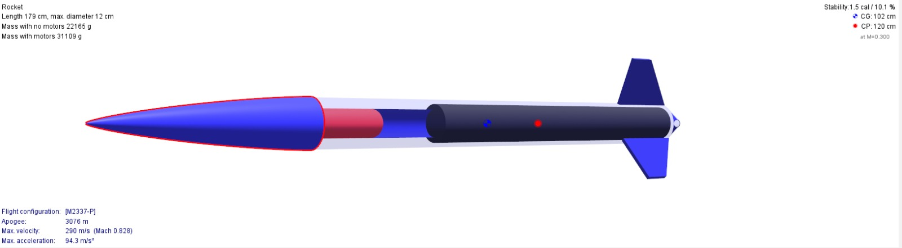

# Protótipo Foguete
O Repositorio contem todos os arquivos utilizados para a criação de um foguete de apogeu de 3km utilizando o enviroment da IREC 2026, juntamente com seus dados metereologicos. 

# Motor
O motor foi gerado pelo openMotor idealizado a partir de um impulso total de 9500 Ns, a partir disso foi definida uma fuselagem e sua recuperação.

# Imagem do foguete

